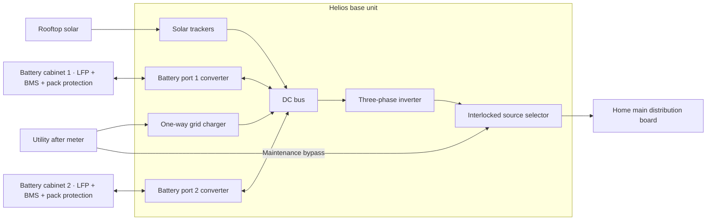

# Project Helios

## Architecture and implementation plan · discussion draft

[Remaining builds, dependencies and acceptance tests](HELIOS-BUILD-CHECKLIST.md)

The first battery-port revision includes editable power and sensing schematics, switching simulations and measured operating points. The circuit comparison records the open-hardware cabinet candidate and published power-converter benchmarks. [Battery-port circuits](circuits/battery-port/README.md) · [Reference designs](circuits/REFERENCE-DESIGNS.md)

**Product goal.** The home normally runs continuously from a battery-backed inverter. A lithium iron phosphate (LFP) bank buffers variations in sunlight and household demand. Solar is the preferred charging source. A one-way utility charger can run while the house is occupied, with its timing and power chosen to carry the home to the next period of useful solar and preserve an outage reserve. The installation should run locally and automatically after commissioning.

**Product range.** Helios targets homes using 4–20 kWh/day with a common controller, expandable solar inputs, independently managed LFP modules and inverter modules sized for the home's phases and peak demand. Grid import uses a one-way charger. The residential installation must prevent reverse power flow to the utility by design. Confirm the service voltage, phase count, earthing and sanctioned load at commissioning. All hardware ratings below are engineering targets.

### Wall-mounted base and battery cabinets

Every installed system has **one Helios base unit and one to four matching battery cabinets**. The starter package is two enclosures on the wall. At maximum storage there are five. The base includes the inverter as standard. The number of internal inverter modules depends on phase configuration. The existing utility meter and household distribution board are the installation boundaries.

| Enclosure | What it contains | External connections |
| --- | --- | --- |
| Base unit | Solar trackers and chargers, one-way grid charger, inverter, control and metering electronics, independent bidirectional converter for each battery port, interlocked transfer and maintenance bypass, and system-side protection. | Rooftop solar input, utility input after the meter, backed-up AC output to the home's main distribution board, and four independently managed battery ports. Meter sensing and protective earth are part of the site interface. |
| Battery cabinet | One 5.12 kWh nominal LFP pack, its battery management system, temperature sensing, and pack-side isolation and fault protection. | One dedicated protected DC and communications link to an available port on the base. The base sets each cabinet's charge or discharge power within its reported limits. |

**Expansion experience.** Use four factory-equipped battery channels in the base as the reference design. Unused channels stay disabled. To add storage, an installer mounts another battery cabinet beside the first, connects it to a free port with the system isolated, and commissions it. The controller verifies compatibility, reads its limits and reports the new usable capacity. Solar, grid and household connections stay in place during a storage expansion. The four-channel hardware cost and its standby draw count toward the entry-level product budget.

**Mechanical target.** Give the base and battery cabinets matching front proportions, finish and mounting alignment. Target the approximate envelope of Tesla Powerwall 3, 1,105 mm high × 609 mm wide × 193 mm deep, for the base. Select battery cabinet depth and wall mounting for the actual pack. Validate component fit, cable entry and bending space, cooling at continuous load, service access, weight and wall loads before setting Helios dimensions. [Tesla UK mechanical reference](https://www.tesla.com/en_GB/support/energy/powerwall/learn/how-powerwall-works)

### Modular platform for 4–20 kWh per day

**Energy configurations for Madurai.** Assume 55% of daily energy is consumed overnight, a full battery at sunset, 20% reserve, 90% battery-to-home efficiency and 90% effective round-trip efficiency for stored solar relative to direct PV. A 5.12 kWh module supplies about 3.69 kWh to appliances before additional standby and aging. Size against actual overnight use where available. The examples use 550 W panels and the local modelled yield of 1,594 kWh/kWp/year. The panel counts are array totals and can include compatible existing panels. [Madurai PV study, Table 5](https://doi.org/10.1093/ce/zkab008)

| Household use (kWh/day) | Panels × 550 W | Array (kWp) | Modelled solar (kWh/day, annual mean) | Overnight target (kWh) | LFP modules | Nominal storage (kWh) |
| ---: | ---: | ---: | ---: | ---: | ---: | ---: |
| 4 | 2 | 1.10 | 4.8 | 2.2 | 1 | 5.12 |
| 8 | 4 | 2.20 | 9.6 | 4.4 | 2 | 10.24 |
| 12 | 6 | 3.30 | 14.4 | 6.6 | 2 | 10.24 |
| 16 | 8 | 4.40 | 19.2 | 8.8 | 3 | 15.36 |
| 20 | 10 | 5.50 | 24.0 | 11.0 | 4 | 20.48 |

These are starting configurations. At 20 kWh/day, three full modules theoretically deliver 11.06 kWh before standby and aging. The fourth provides useful margin. For a home with heavy daytime use, a larger array may suffice with fewer battery modules. Long overnight AC operation or extended outages may call for another module at the same daily consumption. Size night energy first, then check battery discharge power, module charge acceptance, per-phase inverter current, motor starts, weather and roof constraints. If the requirement exceeds the supported one-to-four-module range, change the operating target or qualify a larger bank. Use the grid for deficits.

**Hardware boundaries and expansion.**

- One local controller retains the household configuration and demand history. It discovers commissioned modules and calculates allowed charge, discharge, grid input and AC output from their reported limits. Independent protection in each module remains active if the controller or communications fail.
- The base contains four bidirectional converter channels, each paired with a port for one external 51.2 V, 100 Ah LFP cabinet. On battery alone, budget up to 2.5 kW AC-equivalent per healthy connected cabinet, with lower limits for temperature, voltage or state of charge. The inverter and common distribution limits also apply.
- Use modular solar trackers with an initial design target of 3 kWp each, expandable to two trackers and 6 kWp total. The starter tracker must start and regulate with the two-panel array across the expected roof temperatures. Validate both the smallest and largest compatible strings for voltage and current. Panel expansion may require the second tracker or a revised string configuration.
- Evaluate one family of synchronized 4 kVA inverter modules. One installed module can serve a single-phase home. A three-phase whole-home installation uses three from day one, one per phase with a correctly formed neutral, even when the home uses only 4 kWh/day. Limit the three-phase assembly to the qualified 8 kVA aggregate and 4 kVA per-phase envelope. An occupied battery bay can contribute to any phase. Select service-matched grid charging and transfer equipment for each assembly. One supported single-phase module covers up to 4 kVA with sufficient source power. A higher single-phase peak needs a separately qualified power configuration. [Manufacturer example of synchronized inverter systems](https://www.victronenergy.com/live/ve.bus%3Amanual_parallel_and_three_phase_systems)
- Customers can keep the controller, trackers, batteries and compatible inverter module through an upgrade. Adding energy capacity within a commissioned configuration leaves the original inverter in service. Conversion to three-phase whole-home service requires a compatible three-phase utility supply, two additional matched inverter modules, suitable metering and switchgear, and installer recommissioning. Battery extensions use de-energized, keyed connections with module identity, compatibility and state checks before enabling power.

**Prototype checks at both ends of the range.** For the single-phase starter, deliver 2.2 kWh overnight with one module and verify the 20% reserve. Target at most 10 W of continuous no-load draw for the complete energized starter system (0.24 kWh/day, or 6% of the 4 kWh reference). Measure the three-phase small-bank configuration separately. Check morning tracker startup, part-load efficiency and outage behavior with one battery. Repeat the test after a battery addition and confirm that the controller updates runtime and power limits correctly. For a larger household, exercise three inverters with uneven loads, loss of synchronization, loss of a battery bay and safe recovery. Quote the cost of the starter hardware separately and validate the idle target before adopting a common 4 kVA inverter PCB for production.

### Upper configuration for three-phase homes with four room ACs

The reference customer owns four room ACs and uses them intermittently. Use **20 kWh of whole-home demand per day, including 11 kWh between 7 p.m. and 7 a.m.**, as the first energy-management test. A study of 15 Indian homes with at least three ACs found 20.4 kWh/day in summer and 18.1 in monsoon. A separate all-night-use group in the same study, including different AC ownership levels, used 10.8 kWh overnight. The chosen values are engineering assumptions informed by these observations. An exact four-AC Madurai household average is unknown. The owner's Madurai home provides a separate heavier-use test at 29.4 kWh/day and 16 kWh overnight. [Indian smart-meter study, Tables 1 and 4](https://publications.ibpsa.org/proceedings/bso/2022/papers/bso2022_41.pdf)

| Product requirement | First engineering target | Reason or validation |
| --- | --- | --- |
| Whole-home output | 8 kW and 8 kVA total, three phases plus neutral at 230/400 V, 50 Hz. Up to 4 kVA on any one phase within the total. | Four ACs each drawing 1.2 kW, a 2 kW hob and 0.8 kW of other loads total 7.6 kW. Check real power, apparent power and phase loading. At 0.95 aggregate power factor this example reaches 8 kVA. |
| Battery | Four independently controlled 51.2 V, 100 Ah LFP modules as the reference configuration, 20.48 kWh nominal. Test lower module counts with reduced output. | At 80% usable energy and 90% battery-to-home efficiency, four modules deliver 14.75 kWh before additional idle losses and aging. Three deliver 11.06 kWh, leaving almost no margin for the 11 kWh night. |
| Battery bays | One bidirectional power stage per compatible BMS-equipped module. Budget up to 2.5 kW AC-equivalent continuous contribution per bay, subject to an 8 kW system ceiling. | With four healthy bays at 8 kW AC, 46 V per pack and assumed 90% battery-to-home efficiency, each contributes about 48 A DC. At a three-bay limit of 7.5 kW, each contributes about 60 A under the same conditions. Qualify the actual voltage, temperature, current and module-loss limits. |
| Solar input | Support the owner's 5 kWp goal as the reference, and target up to 6 kWp with two independent solar trackers. Qualify the array voltage/current ranges and clipping against the selected input stage. | At the Madurai model yield of 1,594 kWh/kWp/year, 5 kWp averages 21.84 kWh/day and 6 kWp averages 26.20 kWh/day. Roof geometry, shading and weather affect both. [Madurai PV model, Table 5](https://doi.org/10.1093/ce/zkab008) |
| Grid charging | Import-only three-phase charger. Target an adjustable input up to 10 kW AC, limited by available site current on each phase. Target up to 5 kW DC into the battery bank, shared with solar and limited by each BMS. | The input stage must sustain the 8 kW AC load at its full input rating and deliver only the remaining power to storage. Test steady-state operation and heat at high household load and at the site's lower import limit. |
| Control | Continuous inverter supply, solar as preferred charge source, adjustable 20% reference reserve, local forecast and threshold fallback. | Permit grid support when the forecast or a power constraint requires it. Verify the physical no-export path and interlocked maintenance bypass. |

**Energy balance.** A reference day has 9 kWh of daytime use and 11 kWh overnight. At an assumed effective 90% round-trip storage efficiency relative to direct PV delivery, daily generation required is 9 + 11 ÷ 0.90 = 21.22 kWh before extra standby and curtailment. The 5 kWp model leaves only 0.61 kWh/day on annual-average arithmetic. An additional continuous 25 W of equipment overhead would itself consume 0.60 kWh/day. Meter idle and part-load losses in the prototype and include them once in the hourly energy model. Cloudy sequences can require grid imports even when annual generation exceeds consumption.

**Acceptance criteria for the first prototype.** Deliver the 11 kWh overnight profile from full charge and retain at least 20% state of charge with four modules and grid charging disabled. Repeat the day/night test with measured solar traces, recording imports, curtailment and reserve recovery. Verify 8 kVA continuous in balanced operation and with a 4/2/2 kVA phase split, rotating the heavy load through all three phases. Characterize surge and voltage sag with representative compressor and pump starts. The owner's lift requires a separate compatibility check with its manufacturer. Use the 29.4 kWh pilot day to test forecast-based grid charging.

### Pilot home and solar self-sufficiency

The pilot has four room ACs, with three to four enabled overnight and one to two running around the clock. Other loads include three to five fans, a large fridge, an always-on PC setup described as 1,500 W, a 2 HP pump used every other day, a three-person lift, an electric stove and chimney, a washing machine and an occasional Bambu Lab X1 Carbon print. Existing rooftop solar is reported as about 3 kWp. The owner wants to expand to 5 kWp and cover the whole home with solar and storage. The electricity bill's reported five units need a billing period and register label before use.

The pilot is in Madurai, PIN 625016. The owner clarified that the appliance wattages include maximum ratings and actual use could be substantially lower. The working scenarios below supersede the initial 60–86 kWh/day example for planning. The original inverter, array and pack ratings remain comparison designs pending measurements.

#### Madurai pilot estimates using measured household comparisons

The Indo-Swiss Building Energy Efficiency Project compared three 70 m² flats in the same Chennai complex. Each owned three ACs. Flat A used 3,168 kWh/year. Multiplying the reported annual energy intensity by floor area for flats B and C gives about 4,690 and 6,650 kWh/year. Their whole-flat averages were therefore about 8.7, 12.8 and 18.2 kWh/day for two, four and five occupants respectively. A separate 54-home Indian smart-meter study included 15 homes with at least three ACs. That group's whole-house mean was 20.4 kWh/day in summer and 18.1 in monsoon. The mixed-AC group with an all-night peak used 10.8 kWh between 7 p.m. and 7 a.m. across summer and monsoon. These samples offer benchmarks. The Madurai pilot also has a private lift, electric cooking, an always-on PC and potentially longer cooling hours. [Chennai flats, section 2.3.2](https://www.beepindia.org/wp-content/uploads/2013/12/Design-Guidelines-for-Energy-Efficient-Multi-Storey-Residential-Buildings-Warm-Humid-Climate_5.pdf) · [Smart-meter study, Tables 1 and 4](https://publications.ibpsa.org/proceedings/bso/2022/papers/bso2022_41.pdf)

A PVsyst study of a grid-tied Madurai rooftop modelled 1,594 kWh/kWp per year. Scaling that city estimate gives 4,782 kWh/year for 3 kWp, about 6,535 for 4.1 kWp and 7,970 for 5 kWp. These are annual-average daily outputs of 13.1, 17.9 and 21.8 kWh respectively, before any extra storage losses or export curtailment. The site's shading, inverter and actual monthly production can change these estimates. [Madurai solar model, Table 5](https://doi.org/10.1093/ce/zkab008)

For a ten-hour night and fourteen-hour day, the AC count includes any unit left on continuously. The watts below are assumed time-averaged electrical inputs per enabled AC over the stated hours. The other-load allowances cover the fridge, fans, stove, chimney, washer, pump, lift, printer, lights and miscellaneous loads. Each includes 2 kWh of other loads overnight. All three scenarios are illustrative.

| Scenario | ACs enabled, night / day | Mean W per AC / whole PC setup | Other kWh/day | Total kWh/day | Whole-house kWh in 60 days | Ten-hour night kWh | Nominal LFP kWh for that night |
| --- | --- | --- | ---: | ---: | ---: | ---: | ---: |
| Light | 3 / 1 | 250 / 100 | 6 | 19.4 | 1,164 | 10.5 | 14.6 |
| Middle | 3 / 1 | 400 / 200 | 7 | 29.4 | 1,764 | 16.0 | 22.2 |
| Heavy cooling | 3.5 / 1.5 on average | 550 / 300 | 8 | 46.0 | 2,760 | 24.25 | 33.7 |

For the middle day, ACs use (3 × 10 + 1 × 14) × 0.40 = 17.6 kWh, the PC uses 24 × 0.20 = 4.8 kWh, and everything else uses 7 kWh. Battery nameplate figures assume a full start, 20% reserve and 90% discharge-path efficiency, before aging and additional standby losses. If each row represented the annual average, and the night energy passed through storage at an effective 90% round-trip efficiency relative to the modelled PV yield, PV for simple annual energy balance would be about 4.7, 7.1 and 11.2 kWp respectively. Cloudy-day autonomy, zero-export curtailment, standby draw and reserve recovery can require more. The inverter's aggregate, per-phase and surge ratings still require separate peak-demand measurements.

The reported five EB units could be particularly informative. If the meter shows **imports minus exports = 5 kWh over 60 days** and behind-the-meter PV produced around the model's 786 kWh for that time, whole-home use would be about 791 kWh, or 13.2 kWh/day, assuming negligible storage changes and losses. Use actual same-date inverter generation. Minimum charges, banked credits and gross-meter or net-billing settlements require the individual meter readings instead.

#### Earlier high-use sensitivity

This worked example uses a ten-hour night and fourteen-hour day. The overnight count of 3.5 ACs includes the round-the-clock units. The assumed average of 0.70 kW per enabled AC includes compressor modulation and cycling. Replacing it with an average 0.2 kW higher or lower changes the total by 11.2 kWh/day.

| Load | Assumption to replace with measurements | kWh/day |
| --- | --- | ---: |
| Four ACs | 3.5 units × 10 h at night plus 1.5 units × 14 h in daytime, all at 0.70 kW mean input while enabled | 39.2 |
| PC, displays and speakers | 0.40 kW average at the wall over 24 h as a sensitivity case. At a measured 1.50 kW continuous this line becomes 36.0 kWh | 9.6 |
| Fans | Four at 50 W for 20 h | 4.0 |
| Fridge | Illustrative allowance including compressor cycling | 1.5 |
| Electric stove and chimney | Illustrative daily cooking allowance | 3.0 |
| 2 HP water pump | Assume 2.0 kW electrical input for 30 minutes every two days. 2 HP corresponds to about 1.49 kW mechanical output | 0.5 |
| Three-person lift | Assume 2.0 kW real power for ten total minutes of powered travel plus about 10 W standby. Replace with the actual drive, trips and standby demand | 0.6 |
| Washer, occasional printer, lighting and other loads | Allowance averaged over days | 1.5 |
| **Total** | **About 60 kWh/day at 0.40 kW mean PC demand, or 86 kWh/day at 1.50 kW** | **59.9** |

Manufacturer data illustrate the uncertainty in peaks. At 230 V, the Stiltz Trio's published 5 A supply corresponds to about 1.15 kVA. Nibav quotes about 3.7 kVA on ascent for one residential lift design. Apparent power determines inverter loading alongside startup demand. Billed energy depends on real power, travel time and standby. Bambu lists 1,000 W maximum for the X1 Carbon at 220 V. Confirm lift backup supply, starting and braking requirements and the existing emergency rescue arrangement with the lift manufacturer. [Stiltz Trio India](https://www.stiltzlifts.in/stiltz-trio-home-lift/) · [Nibav residential lift](https://www.nibavlifts.com/residential-lifts/) · [Bambu Lab X1 Carbon specifications](https://public-cdn.bambulab.com/store/bambulab-X1-carbon-tech-specs.pdf?v=20250715085516)

#### Implications if the earlier high-use assumptions hold

- **PV generation.** The Government of India's rooftop solar FAQ gives 4–5.5 kWh per kWp on a clear sunny day. That corresponds to 12–16.5 kWh from 3 kWp and 20–27.5 kWh from 5 kWp. Local season, shading and inverter clipping change these figures. From exactly 3 kWp, two 550 W panels produce a 4.1 kWp array. An extra 2 kWp requires 2,000 W total in additional panel ratings. Check the existing string and inverter limits. [Rooftop solar FAQ](https://static.pib.gov.in/WriteReadData/specificdocs/documents/2022/apr/doc202242850101.pdf)
- **PV sizing sensitivity.** If this roof actually yields 4 kWh per installed kWp per day in the period being evaluated, generating 60 or 86 kWh/day takes about 15 or 21.5 kWp respectively, before storage losses, additional downtime and provision for low-solar spells. Compare available shade-free area and monthly measured yield with these targets. For a roof capped at 5 kWp, model grid imports and backup duration explicitly.
- **Overnight storage.** For ten hours of ACs, PC, four fans and average fridge load, the two PC scenarios give 31.1 or 42.1 kWh at the sockets. At a full start, 80% usable window and 90% battery-to-home efficiency, that is 43.2 or 58.5 kWh nominal for one night, before aging, electronics standby and other overnight use. With the smaller PC assumption, the original 10.24 kWh reference delivers about 2.4 hours at the modelled 3.1 kW night load before reaching reserve.
- **Inverter rating.** As a coincidence example, four ACs each drawing 1.2 kW, a 2 kW hob and a 0.4 kW PC total 7.2 kW before the pump or lift starts. The Nibav example would also exceed the original 2.5 kVA single-phase target by itself if that lift were installed. Record simultaneous demand, per-phase currents and the transients of the actual lift and pump. Reassess the charger, number of battery bays and PV handling capacity alongside the inverter.
- **Year-round independence.** Replay at least a full seasonal cycle of site generation and consumption where available, including consecutive low-generation days. Define how many poor-solar days must be covered at full or reduced load, how quickly storage must recover, and whether the owner accepts occasional grid use. Report unmet demand and grid imports even when annual generation exceeds annual consumption.

#### Measurements for the pilot

The location is established. Start with a redacted bill showing dates and separate import/export kWh, and the solar inverter's generation for the same dates. If solar is behind the meter with negligible storage change and losses, home consumption is approximately imported kWh + generated kWh − exported kWh. Gross metering, an existing battery, or separate meters require their actual arrangement. Ask for a week of PC energy at the wall, AC and lift model numbers, and inverter/panel model or nameplate. Obtain interval load data, per-phase peaks and motor-start measurements before choosing the power board. Use the existing array's measured yield to estimate expansion if roof orientation, shading and conversion limits are comparable.

### Original 5 kVA reference design

One grid-forming three-phase inverter supplies the household distribution board from a common DC link. Each battery bay has an independently commanded bidirectional DC converter. The reference configuration has two qualified 51.2 V nominal, 100 Ah LFP modules, expandable to four. The product specification defines the supported packs, voltage window, current limits, battery-management communications and protection. Qualification includes a reduced-power configuration with one module and operation at low charge and high temperature.

| Function | Discussion target | Meaning for the homeowner |
| --- | --- | --- |
| Household supply | Three phases plus neutral, 50 Hz. Reference voltage is 230 V phase-to-neutral and 400 V phase-to-phase, with the 240/415 V service profile to be verified where applicable. Target 5 kW and 5 kVA continuous across all phases with two or more modules. One module targets 2.5 kW and 2.5 kVA total. | All three phases stay available within the current and power limits. Ordinary phase-to-neutral appliances and compatible three-phase loads can run together. |
| Uneven loading | Test 2.5 kVA continuous on any one phase, subject to the aggregate limit, sufficient battery power and the qualified neutral-current limit. At 230 V this is about 10.9 A on that phase. | A 2.4/1.6/1.0 kVA split fits the reference target. A 3.0/0.5/0.5 kVA split exceeds one phase's limit. Compare against a larger inverter or reallocation of household circuits if the measured profile exceeds either rating. |
| Motor starts | Test target of 7.5 kVA aggregate for 3 seconds with at least two modules. Qualify both a three-phase pump start and a single-phase compressor start while other loads are running. | Publish per-phase starting current and duration, allowable voltage sag and required pack configuration after testing. |
| Storage | 5.12, 10.24, 15.36 or 20.48 kWh nominal. Default bundle is 10.24 kWh. | The third and fourth modules primarily add runtime. Firmware adjusts output to the capability of online modules if one leaves service. |
| Solar input | Up to 6 kWp of compatible panels, two independent maximum power point trackers, 5 kW combined DC output target. | Panel nameplate capacity sets the proposed array ceiling. Verify string voltage range, cold open-circuit voltage, and per-input current against the selected input stage before specifying an array. Surplus above demand plus permitted charging is curtailed. |
| Utility input | Adjustable three-phase one-way charger, up to 6 kW AC input in total at nominal line voltage, capped by available current on each incoming phase. | Aim to sustain a 5 kW home load from grid input alone at full input rating. If an incoming phase fails, suspend grid charging and inhibit bypass. The inverter can maintain all three output phases while solar and battery limits allow. |
| Battery charging | Up to 2.5 kW DC per module, 5 kW DC combined, shared across solar and utility charging. | The controller obeys each module's live charge limit. Input power also supplying the house is unavailable to charge the pack. |
| Operating controls | Continuous inverter supply, import-only grid port, adjustable outage reserve and local forecasting with a threshold fallback. | Solar is the preferred charge source. Grid charging can run early or cover live demand to preserve reserve. A qualified, interlocked service bypass can feed the home during maintenance. |

**Sizing checks.** At an assumed 46 V under load and 90% battery-to-AC efficiency, 5 kW at the house requires about 121 A from the bank, roughly 61 A per module with two sharing equally. Check the selected modules at the actual minimum pack voltage, worst current imbalance and enclosure temperature. Confirm intended continuous output at a proposed 40°C ambient and determine thermal derating above it. For runtime, a full 10.24 kWh bank using an 80% energy window at 90% efficiency delivers about 7.37 kWh AC, before additional standby draw and aging. Measure losses at typical night loads since the inverter stays on.

**Commercial reference points.** Tesla's UK Powerwall 3 lists 13.5 kWh per main unit and nominal AC output settings up to 11.04 kW at 230 V. Self-Powered mode supplies daytime loads from solar and stores surplus for later. Grid charging is available subject to configuration. [Tesla UK ratings](https://energylibrary.tesla.com/docs/Public/EnergyStorage/Powerwall/3/Datasheet/en-uk/Powerwall-3-Datasheet-EN.pdf) · [Self-Powered operation](https://www.tesla.com/en_gb/support/energy/powerwall/mobile-app/self-powered) · [Grid charging](https://www.tesla.com/en_gb/support/energy/powerwall/mobile-app/advanced-settings)

Anker's European SOLIX X1 is a relevant whole-home comparison. Its three-phase hybrid family spans 5–12 kW. Anker describes independent charge and discharge control and fault isolation per battery module. The newer US SOLIX E10 uses 6.144 kWh modules, with a 7.68 kW continuous backup output rating for the power unit. These are regional product references. Helios targets continuous inverter supply with a one-way utility charging path in normal operation. [Anker X1 EU specifications](https://www.ankersolix.com/eu/x1-energy-storage-system-hes) · [Anker E10 manual](https://support.ankersolix.com/s/article/Anker-SOLIX-E10-A17E1-A17E1141-85-User-Guide) · [E10 modes and modules](https://www.ankersolix.com/blogs/home-power-backup/ac-vs-dc-coupled-battery-existing-solar)

### What Helios changes

Under a typical behind-the-meter installation, solar already supplies coincident household demand. Net metering reconciles imported and exported units. Net billing values imports and exports separately. Gross metering accounts for all generation and consumption separately. A bill with daytime generation and evening imports can therefore look quite different from the power flow at noon. Confirm the site's arrangement and any conditions on changing it before modelling savings or reusing its array. [Ministry of Power metering definitions](https://goaelectricity.gov.in/Regulations/Rights%20of%20Consumers%20%28Amendment%201%29%202021.pdf) · [KSEB rooftop solar FAQ](https://ekiran.kseb.in/public/faqs)

For scale, suppose the marginal import rate is ₹12/kWh, the export credit is ₹2.40/kWh, and a surplus kWh sent into storage delivers 0.90 kWh to the home later. That cycle avoids ₹10.80 of imports and forgoes ₹2.40 of credit, leaving **₹8.40 per surplus kWh stored** before battery wear, standby costs and capital recovery. This example assumes separate import and export prices and enough later demand. Where a banked export offsets a later import one-for-one, backup may account for most of the battery's value. Apply the actual tariff and settlement period to a year of estimated flows.

### Battery-first architecture

The diagram shows a three-phase base with two battery cabinets. Two additional battery ports are available. The single-phase base contains one inverter module and service-matched grid input, metering and bypass.

The DC bus is the common point for the chargers, battery interface and home inverter. The solar converter tracks the array's maximum power point (MPPT) when the home or bank can accept the energy. The inverter establishes the home's AC voltage and frequency. Passing clouds and scheduled grid charging change DC power flows while the home stays on that inverter. During service an interlocked bypass can supply the house directly from the utility. The selector must disconnect one AC source and verify its position before connecting the other. [Schneider Electric explanation of double conversion](https://www.se.com/in/en/faqs/FAQ000244169//)

On a common bus, the bank experiences the difference between charger output and inverter demand. If both measure 1 kW on the DC side, net battery power is approximately zero. If a cloud drops solar output to 0.2 kW, the bank provides 0.8 kW. If solar rises to 1.5 kW, the bank can absorb 0.5 kW. These examples omit auxiliaries and assume the bank is within its limits. The same arithmetic applies to the utility charger. Its output must exceed concurrent inverter demand for the bank to gain charge.

**Cost of this choice.** The home inverter carries the entire simultaneous household load whenever it supplies the home, including when the utility contributes. Imported energy passes through two conversion stages. Measure full-load heat, overnight idle draw and low-load efficiency before committing to this topology. A simpler non-parallel changeover could move the entire house to the grid when local sources fall short. That saves the rectifier sizing and conversion penalties for grid-assisted loads, at the cost of losing the ability to blend solar with just the required grid import.

**Grid-parallel alternative.** If the requirement is zero scheduled export and the local distribution company accepts export limiting, a hybrid inverter can share the load directly with the grid. It needs metering at the utility connection, export control on the relevant phases, a defined response to meter loss, anti-islanding protection and verified grid disconnection before forming a backup supply. A sudden load drop can briefly send power upstream despite a zero-export setting. Compare the two approaches against the site's export requirement and measured demand. [Victron ESS feed-in FAQ](https://www.victronenergy.com/media/pg/Energy_Storage_System/en/frequently-asked-questions.html) · [CEA connectivity regulations](https://www.cea.nic.in/regulations-subcategory/bfbde7c6-6263-4966-9fe0-14af26aa9cfb?lang=en)

**Existing equipment.** The diagram assumes Helios controls the solar array. Record the existing panel strings, inverter, home UPS, meter arrangement and any generation agreement. A separate grid-tied inverter could still export through its own connection. Keeping it requires a compatible retrofit design and an outage operating strategy. Reusing the panels on a DC input requires their voltage and current range to match the new converter.

### Choosing the LFP arrangement

Compare the candidates at equal total usable kWh, equal household peak load and equal backup target. Splitting the same capacity into two enclosures adds no overnight energy by itself.

| Battery arrangement | What it buys | What determines whether to choose it |
| --- | --- | --- |
| One protected pack | Simplest interface. The bank naturally absorbs the difference between source and load. | The single pack must carry the entire inverter load and starting surge. Taking it out of service removes battery backup. |
| Matched protected modules connected directly in parallel | Lower-cost comparison for the prototype. Approved packs share current according to their electrical characteristics. | Individual monitoring and disconnects provide protection. Commanding a particular current in each active pack requires an additional current-regulating stage. |
| Independently controlled packs on a common DC link | Preferred Helios configuration. A bidirectional converter per bay lets the controller reduce, raise or stop current for that pack as its temperature, state of charge or available power changes. | Compare added cost, heat, low-load efficiency and standby draw against the direct-parallel reference. Qualify each compatible module and the response to losing one under load. |
| Strict alternating banks | The chargers fill A while B alone feeds the inverter. Their roles swap. Energy supplied by the active pack has actually been stored. | Each active bank must sustain the required load and surge by itself. Test changeover at peak load and handle the case where the next bank is still depleted. Extra stored-energy throughput and changeover hardware buy explicit separation. |
| Working bank with a standby bank | One pack can be held for outages, maintenance or failure of the other. | A logical reserve in the shared bank suffices for ordinary reserve scheduling. A physical reserve adds value when isolation or surviving a pack fault matters. The inverter is still a common point of failure. |

For a one-hour example with 1 kW solar and 1 kW demand, measured at the DC bus and idealizing losses, the shared bank exchanges about zero net kWh. Strict alternation puts 1 kWh into A and draws 1 kWh out of B. Both serve 1 kWh of household demand in this idealized comparison. Real stored-energy paths incur losses, and wear depends on the cells, temperatures, currents and operating window. Calculate absolute pack throughput and losses from logged data before assigning a lifetime or payback. [Victron examples of parallel LFP banks and managed redundancy](https://www.victronenergy.com/media/pg/Lynx_Smart_BMS_NG/en/introduction.html)

### Other choices that can be combined with these banks

The inverter forms all three phases 120 electrical degrees apart and provides a neutral suitable for unbalanced and nonlinear loads. Battery bays pool their power on the DC link, so any available module can contribute to any AC phase. Monitor output current and voltage on every phase, neutral current, phase sequence and the input conditions for bypass. Determine neutral and earth treatment for the site's earthing arrangement. Qualify bypass interlocking in the presence of phase loss, wrong phase sequence and neutral faults.

During normal charging, allocate more current to modules with available charge headroom, within each BMS limit. During discharge, share demand among healthy modules according to their available power. Avoid circulating energy from one module into another as a routine operating mode. A pack fault or lost BMS link disables its bay and causes an immediate recalculation of available output. Keep all three phases running if the remaining power suffices, shed agreed loads when possible, and shut down safely if the limits are exceeded. A common inverter or DC-link fault can still interrupt the home.

| Design choice | Options and implications |
| --- | --- |
| Battery interface | A battery-voltage DC bus can use equipment compatible with the pack's full working range. A regulated DC link uses a bidirectional converter to decouple battery and inverter voltage. A higher-voltage pack reduces current at a given power and changes insulation, service and protection requirements. Select the voltage class after the power target and available battery modules are known. |
| Solar input | DC-coupled solar can charge the bank or support the inverter through a controllable MPPT stage. AC-coupled solar can preserve an existing rooftop inverter. To harvest solar during an outage, the existing unit must operate with a compatible grid-forming battery inverter and accept curtailment when the bank is full. Mixed DC and AC coupling is possible for a retrofit with an additional array. [SMA off-grid system planning guide](https://files.sma.de/downloads/OffGrid-System-PL-en-27.pdf) |
| Utility input | A one-way charger retains inverter-fed operation. A source-transfer system moves the house to utility AC on low charge and can refill the bank while on grid. A grid-parallel hybrid blends AC power efficiently and needs an accepted export-control and islanding design. A fully off-grid variant omits the charger and must size for the selected poor-solar period or shed loads. |

### Operating policy

| Situation | Required behavior |
| --- | --- |
| Daytime surplus | Supply the home directly. Charge the pack within the limits reported by its battery management system (BMS). Reduce solar generation when demand and charge acceptance are both satisfied. |
| Cloud, evening or sudden demand | The bank immediately covers the DC shortfall within its power limit. Keep the grid charger idle while projected energy covers demand and reserve. Enable it early enough to close a predicted deficit or to uphold a firm reserve. Apply an immediate power-limit override or shed discretionary loads if the bank cannot support the load. |
| Utility outage | In normal inverter-fed operation, the home already has its own AC source. Continue on available solar and battery, release the outage reserve, and defer selected loads if necessary. Verify interruption time separately for an outage during bypass. |
| Prolonged outage | Shed discretionary loads before essential ones. At the pack's protective floor, shut down cleanly. Define the energy and control-power requirements for restarting from morning sun and for recovery when grid power returns. |
| Grid recovery or fault | Qualify all incoming phases, sequence, voltage and frequency before accepting input. Add hysteresis to avoid repeated switching. A module trip inhibits its bay. A failed source-position check inhibits transfer. An inverter fault permits utility bypass only when the failed source is proven disconnected and the utility is healthy. |

The outage reserve and the pack's protective floor serve different purposes. The reserve is energy the homeowner can use during a cut. The floor protects the cells. Battery charge, discharge and temperature limits stay in effect in every state.

The local controller measures solar power, pack current and state of charge, grid input, per-phase house demand and equipment temperatures. It commands converters and any agreed load shedding. Independent pack and converter protection must be able to interrupt faults even if the controller freezes. Record source changes, limiting conditions and trips so the installer can diagnose an unexpected shutdown.

### Learning when to charge

1. **Start with a local rule that works on day one.** Define an adjustable low-charge warning, a homeowner reserve and the BMS protection limits separately. Configure start and stop thresholds, minimum charger run time and a conservative fallback if the forecast is missing. A firm reserve requires import whenever available local energy would otherwise fall below it. Emergency use of that reserve during an outage is a separate setting.
2. **Learn the household's demand.** Begin with measured load by time of day and weekday or weekend. Update the estimate from recent nights and live power, especially when an AC starts. Forecast usable PV from past production and, when available, weather. Plan until PV can sustain the home on a conservative forecast. Dawn can arrive hours before useful generation on a rainy morning.
3. **Replan at short intervals.** For each interval, project battery energy from demand, solar, charger power, conversion and standby loss. Enforce power and energy bounds throughout the night. Start charging by the latest time that still meets the reserve under the conservative forecast. Set charger power within the utility input and pack limits. Stop once the projected shortfall is covered with margin. Leave capacity for morning solar. Track reserve violations and unnecessary imports to tune that margin.
4. **Test more complex control offline.** Compare the threshold rule, a rolling forecast scheduler and any reinforcement-learning policy on the same unseen household traces with outages, weather errors and changed AC use. Score unmet load, reserve violations, grid kWh and cost, battery throughput and curtailed solar. Keep hard protection and fallback rules independent of any learned policy. A home-energy lab comparison found simple rules competitive with predictive control under its tested conditions. [Experimental comparison of home-energy controllers](https://arxiv.org/abs/2408.07435)

**Two homes at 2 a.m.** Assume a 10 kWh bank at 20%, an illustrative 10% operating reserve, 90% battery-to-socket efficiency, and four hours to useful solar. The bank can supply about 0.9 kWh at the sockets before reaching the reserve. At an average 0.2 kW, the home needs 0.8 kWh and may reach morning with no grid charging. At 0.8 kW, it needs 3.2 kWh and requires help for at least 2.3 kWh of socket demand. Metered grid imports will be larger because of conversion losses. Both estimates omit standby and forecast margins. If the homeowner sets 20% as a firm reserve, all remaining demand needs another source once the bank reaches 20%.

### Whole-home sizing

Size **power** from what must run together and **energy** from how long it must run. A 1 kW load over six hours consumes 6 kWh at the sockets. With an illustrative 90% battery-to-AC efficiency and 80% of nameplate energy available for that duty, the starting estimate is 6 ÷ (0.90 × 0.80) ≈ **8.3 kWh nameplate** before additional allowances for standby draw and aging. If the same 6 kWh must still be available at the end of a normal evening, reserve it explicitly and size the evening cycling window in addition.

Measure simultaneous running kW and kVA, pump and compressor starts with their durations, and demand on each phase. Offer a whole-board backup mode with agreed loads such as a geyser deferred on overload. If every appliance must operate at once, size the inverter, pack discharge capability and distribution equipment for that case. Size solar from daytime use plus the energy needed to recharge the battery on representative local days, including monsoon conditions. A 1 kW array rating alone says little about the kWh available after sunset.

### Implementation sequence

| Stage | Work and decision to be made |
| --- | --- |
| 1 · Characterize the home | Capture the state, distribution company, bill and metering agreement, phase count, sanctioned load, existing equipment and installation environment. Obtain interval load and generation data if available, a list of large appliances and starts, typical outage duration, acceptable interruption and installed-cost target. Produce a one-page site specification. |
| 2 · Size and compare | Replay 4, 8, 12, 16 and 20 kWh days and the heavier pilot traces. Compare the chosen panel and pack counts against roof yield, time of use and phase peaks. Record imports, curtailment, unserved load, pack throughput, reserve, idle draw and conversion losses. Verify the single-phase starter and the 8 kVA three-phase system separately, and cost the controller, solar tracker, occupied battery bay, inverter and service equipment for each. |
| 3 · Define interfaces and protection | Specify PV input range, battery voltage options, pack current and BMS protocol, converter limits, grounding and neutral arrangements, fault clearing in inverter and bypass modes, service isolation, thermal limits and enclosure. Document the applicable utility, electrical safety and equipment conformity requirements with the installer and test lab. Produce a system one-line diagram, operating-state table and fault-response specification. |
| 4 · Validate before a custom board | Simulate energy management and transients. Use a current-limited, low-voltage bench model for power sharing, reserve and recovery logic. Use representative power modules, a grid simulator and controlled loads in a qualified lab for power, thermal and protection tests. Set numerical pass criteria from the site specification before testing. |
| 5 · Release the PCB brief | Use validated limits to assign the PV stage, battery interface, grid input, inverter, sensing and independent protection to board assemblies. Define connectors, isolation boundaries, serviceable parts and production tests. A packaged LFP module with a documented BMS is the reference battery. Supporting loose cells adds a separate pack design covering cell sensing, balancing, containment and protection. |
| 6 · Qualify the complete appliance | Validate with the intended pack, switchgear and enclosure. Demonstrate isolation and fault clearing in every source mode, transfer under load, restart after depletion, operation at site temperature and sustained whole-home loads. Finish the applicable conformity and site-approval work, followed by commissioning by a qualified electrical professional. |

**Acceptance scenarios to carry into the PCB brief.** At midday, remove the largest running load with the battery full. Record upstream power and DC-bus response. At night, remove grid input with the battery at its reserve and start the largest permitted motor. Record per-phase output, interruption time and runtime. With the pack at its protective floor, restore sunlight and then repeat with utility power alone. Exercise a missing BMS heartbeat, an invalid transfer-contact indication and a failed cooling path. Each case needs an observable safe outcome and a reproducible recovery path.

For the three-phase prototype, apply the reference 4/2/2 kVA split and repeat with the heavy load on each phase. Record phase-to-neutral voltage, neutral current, converter temperature and losses. Exercise the loss of an incoming phase during inverter-fed operation, and verify that bypass stays inhibited. With unequal module states of charge, demonstrate independent charge limits through a full-charge event on one bay. Trip one bay under light load and again above the surviving bays' combined rating. Verify continuity within the remaining capacity and protective action beyond it.

**Next pilot inputs.** The owner has supplied the location, appliance inventory and whole-home objective. The next sizing revision needs matching billing and solar generation records, measured PC energy and lift model. Verify whether the proposed two panels can add 2 kWp and how much additional shade-free roof area could accommodate an array sized to the actual load.
